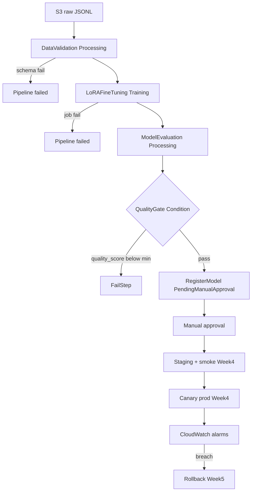

# Architecture

## Control vs data plane

| Layer | Owner | Responsibility |
|-------|--------|----------------|
| GitHub Actions | Software delivery | Test, OIDC auth, upsert pipeline, start execution |
| SageMaker Pipelines | ML orchestration | Validate → Train → Eval → Condition → Register |
| Terraform | Platform infra | S3, IAM, ECR, OIDC role, Budget, log groups |
| Deployment controllers (`deployment/`) | Release | Staging, canary, rollback (Week 4–5) |

Training jobs are **ephemeral**. Do not create them with Terraform.

## Pipeline graph

## Lineage recorded per model version

- Dataset hash (`validation_manifest.json`)
- Git SHA (pipeline env / lineage.json)
- Base model id + revision
- LoRA hyperparameters
- Evaluation report (`evaluation.json`)
- Training container image (SageMaker DLC)

## Two gates

1. **Training Gate** — `pipeline/quality_gate.py` + ConditionStep (`quality_score`, `eval_loss`)
2. **Deployment Gate** — endpoint health, P95 latency, error rate, canary alarms (Week 4–5)
